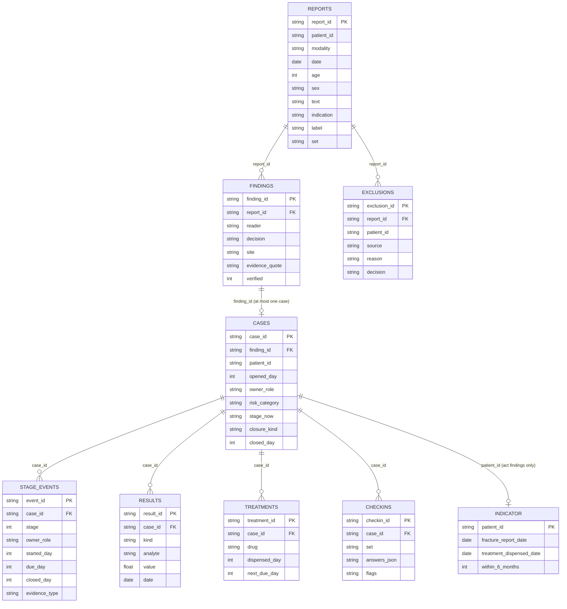

# OsteoLoop data model

The datasheet behind the app. Each entity links to the next by an explicit ID, so a single fracture report can be traced to the treatment it led to and to the indicator row it contributes to. Every row is synthetic. The files are in `data/`.

Regenerate and check:

```bash
npm run data     # export-data.js writes data/*.csv, then run-data.js checks them
npm run bench    # includes the data check
```

`bench/export-data.js` is deterministic. It reads the real code (`src/finder.js`, `src/rules.js`, `src/checkin.js`) and the synthetic reports (`bench/reports.js`, `bench/reports-stress.js`). It copies the seeded case fixtures from `index.html` rather than editing that file. `bench/run-data.js` reads the CSV files back from disk and checks them, so it tests what was written.

## Entity map



`patient_id` is an attribute, not a table. Each synthetic report has its own patient, so the same ID links REPORTS, CASES, EXCLUSIONS and INDICATOR. `run-data.js` checks that the patient on a case matches the patient on the report behind its finding.

## Tables

**reports.csv** holds the radiology reports, one row each. There are 115: 100 development reports and 15 stress reports, the same set the finder benchmark uses. Each report has a synthetic patient, a modality, a date, age, sex and report text. `label` is the hand-written expected answer (act, review or no), and it is still a draft pending clinical sign-off.

**findings.csv** holds what the finder read from each report: one row per report, with `reader = keyword`. The decision (act, review or no), the body site, the quoted evidence and a `verified` flag come from `find()` and `verify()` in `src/finder.js`. `verified = 1` means every quoted sentence is verbatim in the report and supports the decision. The AI reader is not in the file, because it needs an API key that this run did not have. Its rows will use `reader = ai` when `npm run bench:finder-ai` output is added.

**cases.csv** holds the cases that were opened. A case is opened from exactly one finding, and that finding must be an act or review decision that passed verification. There are 8 cases, one per seeded case in `index.html`. The risk category comes from `category()` in `src/rules.js`. `stage_now` is the open stage number, or `closed`. `closure_kind` and `closed_day` record how a case was closed (treated or drop).

**stage_events.csv** holds one row for each stage a case has reached (34 rows). Each row has the stage (0 to 6), the role that owns it, when it started, when it is due, when it closed, and the evidence that closed it. Due days use the app's clock: the stage's clock, with 42 days at the confirm stage for urgent cases.

**results.csv** holds the DXA and lab values entered for a case (20 rows). `kind` is DXA, lab or SPEP. No SPEP rows exist, because the seeded cases do not record one. Each lab value has an `analyte` and unit in its name.

**treatments.csv** holds the prescription for each case that has one (3 rows). `dispensed_day` is blank when the drug was prescribed but not yet dispensed. For denosumab, `next_due_day` is dispensed plus 182 days, which is the LOCAL rule in the app.

**checkins.csv** holds the patient check-in answers (1 row, a review check-in). `answers_json` is the answer set. `flags` is the list of flag IDs that `flags()` in `src/checkin.js` produces from those answers. Patient answers never change the risk category.

**exclusions.csv** holds the reports that were skipped before a case opened, because the records lookup showed the patient was already on treatment or receiving palliative care (2 rows). Their reports have no case, and `run-data.js` checks that.

**indicator.csv** holds the proposed indicator, which is the fragility-fracture patients started on treatment within 6 months. It is derived from the act findings: one row per patient whose case was opened from an act finding. `within_6_months` is 1 when the dispensing date falls at most 180 days after the fracture report date. The denominator is 5 and the numerator is 1. The indicator is not in DoH's 2025 orthopaedic Jawda set.

## Columns beyond the brief

These columns were added to make the links and the checks work. Blank means not applicable.

- `reports.indication`, `reports.label`, `reports.set`: the finder reads the indication as part of its trauma check, so it is kept. `label` is the benchmark expectation and `set` is `dev` or `stress`.
- `results.analyte`: distinguishes the lab values, which share the kind `lab`.
- `cases.closure_kind`, `cases.closed_day`: a drop closes a case without any stage event, so the closure needs its own fields.
- `exclusions.source`, `reason`, `decision`: the exclusion source (pharmacy or records), the reason shown in the app, and the outcome.
- Booleans are 1 or 0. `answers_json` and `flags` are JSON.

## Worked example: one patient from report to indicator

Patient `P-0087`, a 73-year-old woman. Every ID below is in `data/`.

1. **Report.** `R087` (`reports.csv`), XR thoracic spine, 2026-04-21, indication "Fall": "Fall from standing. No acute fracture is seen; however there is a chronic wedge deformity of T6."
2. **Finding.** `F-0087` (`findings.csv`), keyword reader, decision `act`, site `vert`. The quoted evidence is "however there is a chronic wedge deformity of T6.", and `verified = 1`.
3. **Case.** `C-1004` (`cases.csv`), finding `F-0087`, patient `P-0087`, opened on day -200 (2026-04-21), owner GP, risk `vhigh`, stage `closed`, closed as `treated` on day -60. The risk is very high because the FRAX hip value of 5.0% is above 4.5% (rule VH9).
4. **Stage events** (`stage_events.csv`): `E-0018` (screen, day -200) through `E-0024` (close, day -60). The treatment stage is `E-0022`, a dispensing record closed on day -160.
5. **Results** (`results.csv`): `RS-0009` to `RS-0012`, dated 2026-04-24. The lowest T-score is -2.7, vitamin D 90 nmol/L, eGFR 65 mL/min, adjusted calcium 2.32 mmol/L.
6. **Treatment** (`treatments.csv`): `T-0002`, denosumab, dispensed on day -160 (2026-05-31), next dose due on day 22 (2026-11-29).
7. **Indicator** (`indicator.csv`): `P-0087`, fracture report date 2026-04-21, dispensed 2026-05-31, `within_6_months = 1`. Dispensing came 40 days after the report.

## Real and simulated

**Real, from the repo:**
- The rule logic: `src/rules.js` (risk categories, treatment blocks, denosumab interval), `src/finder.js` (finding and verification) and `src/checkin.js` (check-in flags). The findings and flags in the CSV files come from running this code.
- The clinical sources the rules cite: NICE NG259, the Malaysian CPG on postmenopausal osteoporosis (2022), and the LOCAL items awaiting sign-off.
- The report wording. The report texts are hand-written to mimic radiology language. They are not copied from real records.

**Simulated:**
- Every patient. Patient IDs are generated, and there are no names, dates of birth or identifiers.
- Every date. Day 0 is 2026-11-07, the app's day 0, and every other date is an offset from it. Dates for reports that did not open a case are generated.
- Owners, which appear as roles only (GP or unassigned). The app's named clinicians are not in the data.
- The seeded case values (risk inputs, lab results, dispensing and stage dates) come from fictional fixtures in `index.html`.
- The records-lookup exclusions (pharmacy and palliative) are simulated. The real app has no records connection.
- The patient check-in: one synthetic answer set.
- The mapping from each seeded case to a report. The export picks, for each seeded case, the verified finding whose site and age best match the seeded note. The seeded case was not derived from the report, so the link is a stand-in, not a real trace.

## Known limitations

- The AI reader has no rows, so the file holds only the keyword reader's findings.
- No SPEP results. The seeded cases do not record one.
- The finder's evidence splitter breaks sentences at "however". For F-0087, the quoted evidence is "however there is a chronic wedge deformity of T6.", which drops the words "No acute fracture is seen;" that come before it. The quote is verbatim, so it passes `verify()`, but a reader sees only the fracture statement. This should be fixed in `src/finder.js`, which is outside this change.
- Some seeded cases are not supported by their linked report. C-1004's seed note is a vertebral fracture, and its report describes a chronic wedge deformity. The risk category comes from the seed fields, not from the report text.
- The indicator denominator is 5, so the proportion means little. It is a structural test of the linkage, not a measure of performance.
- The check-in and results tables are small. They show the shape of the data, not its range.
