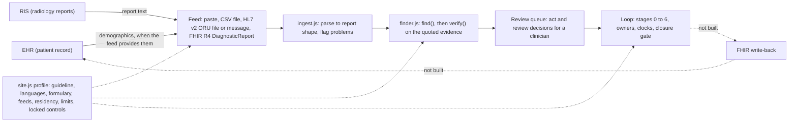

# OsteoLoop integration architecture

Status: prototype. Nothing in this repo is connected to a live hospital system. The ingest layer (`src/ingest.js`) and the site profiles (`src/site.js`) are tested only on synthetic inputs in `bench/ingest-fixtures/`. Where a hospital's systems are named below, the names are placeholders; no real hospital interface, vendor product or specification was used.

## Principle

Hospitals already run electronic health records (EHR) and radiology information systems (RIS). OsteoLoop is a thin layer on top. It reads radiology report text, flags fractures that were documented but not acted on, and keeps the case loop (owners, clocks, closure gate). It does not replace the record. The hospital keeps the source of truth, and each site adapts OsteoLoop through a site profile rather than through code changes.

PACS (images) is not in scope. OsteoLoop reads report text, not images.

## Architecture

Current state of each box:

| Box | Where | State |
| --- | --- | --- |
| Feed (paste, CSV, HL7, FHIR) | `src/ingest.js` | Parsers built and tested on synthetic fixtures. No live feed. |
| Ingest | `src/ingest.js`, `ingest()` and `toFinderInput()` | Built. Never throws. Returns `{ok, report, reports, warnings, errors, flags}`. |
| Finder and verifier | `src/finder.js` | Built (keyword baseline, plus an optional AI reader in the app). |
| Review queue and loop | `index.html` | Built as a prototype with seeded demo cases. The Find tab imports paste, CSV, HL7 v2 and FHIR text through `ingest()`; imported reports join the finder list unreviewed, and held ones go to review. No live feed. |
| Site profile | `src/site.js` | Built with three templates. Validates and merges per-site overrides. `index.html` reads stage clocks, default language, guideline label and data residency from the active profile. Invalid overrides are refused and shown. |
| FHIR write-back | none | Not built. `src/fhir.js` only builds a downloadable FHIR R4 bundle for one case. It makes no network calls. |

## Deployment modes

The same code serves three modes. A site starts at mode 1 and moves on only when the earlier mode is proven.

| Mode | Data path | Write-back | What it needs from the hospital | Status |
| --- | --- | --- | --- | --- |
| 1. Paste or CSV (no integration) | A staff member pastes report text, or exports a CSV from a report search the site already has | None. Nothing is sent back | Agreement on which reports are exported and who may do it. A data-protection decision about where the file is kept | Parsers tested (paste, CSV). No live use |
| 2. File or HL7 feed (read-only) | The RIS or an interface engine writes ORU^R01 result messages, or FHIR JSON, to a location OsteoLoop reads | None | An interface or integration team that can send a copy of result messages (ideally only for the studies that matter) over a transfer path the site already governs. Agreed character set (MSH-18). Test messages. A data-protection approval for the feed | HL7 v2 ORU^R01 and FHIR DiagnosticReport parsers tested on synthetic files. Not run against a site feed |
| 3. FHIR R4 (read and write-back) | Read: DiagnosticReport from the site's FHIR server. Write: Task, Communication or similar, back to the record | Yes, once built | A FHIR base URL, the site's authorisation model and client registration, a test tenant, the terminology the site uses (LOINC, SNOMED CT or local codes), and a review of the site's FHIR conformance statement | Not built. Only the download bundle exists |

Mode 3 is the only mode with write-back, and it is the last step. Do not start it before modes 1 and 2 have run on the site's own de-identified samples, and before the clinical lead has signed off the loop.

## What each mode needs from the IT team

Mode 1 needs very little: a named user, a rule about what may be copied, and where the copy is kept.

Mode 2 needs:
- A named contact on the integration team, and a change-control route for the feed.
- A sample of de-identified result messages from the site's RIS, with the MSH-18 character set value and any local segment or extension notes.
- An agreed transfer path (file drop, or a listener the site already operates). OsteoLoop does not open network ports in this prototype.
- A decision on which studies are sent. Sending every report is simpler to set up, but it sends more text out of the site.
- Access logging on the feed location, and a downtime procedure: what happens to reports that are not read.

Mode 3 needs everything in mode 2, plus:
- A FHIR base URL and a test environment.
- The site's authorisation method, client registration and scope list.
- A list of resources the site will allow OsteoLoop to read and write.
- Agreement on terminology. The current export uses local codes (`urn:osteoloop:local`), not LOINC or SNOMED CT, and no codes have been invented.

## Security notes

- Read-only first. Modes 1 and 2 read reports and write nothing back. Write-back (mode 3) needs its own review.
- No report text leaves the site profile's data-residency mode. `validate()` enforces the one rule it can check: `local-only` allows only the keyword reader, so no text goes to a model.
- `deidentified-external` and `external-allowed` are the site's assertion, not something the code can check. OsteoLoop does not de-identify text. If the site uses an external reader, the site must strip names, MRNs, dates of birth and addresses before the text is sent, and must check that the accession or order id it sends is not a patient identifier. The report `id` is sent to the AI reader because the AI batch prompt includes it. Report text can also contain names by accident.
- Patient identifiers are kept on the report object only for linking (`patient_id`). `toFinderInput()` removes `patient_id` and `date`, so the finder and any AI reader never receive them.
- Report text is kept exactly as received, because the verifier checks quotes against it. HTML in text is flagged (`html-markup`), and any screen that shows report text must escape it. The parsers never execute or render anything.
- Inputs are bounded by the profile's limits: input size, report length, row count, segment count, OBX count and bundle entries. An input over a limit is an error with no reports. It is never silently cut short.
- A parse with any error returns no reports, so a half-read message cannot be used.
- Prototype-pollution keys (`__proto__`, `constructor`, `prototype`) are tested in JSON, CSV headers and profile overrides. They are ignored or refused.
- Safety controls are locked. A site profile cannot switch off the verifier, human review or the closure gate. `validate()` and `merge()` refuse any attempt.
- Only synthetic data is in this repo. Keep real reports out of the repo, and out of `bench/ingest-fixtures/`. A site's own de-identified samples should be run from outside the repo.

## What is not built or validated

- No live feed has been connected, and no site's message or resource samples have been tested.
- HL7 v2 parsing covers ORU^R01 result text (OBR and OBX; value types TX, FT and ST). Batch headers (FHS, BHS), other message types, ORC order linkage, HL7 v2 versions beyond the common 2.x forms, and local Z-segments are not handled.
- The HL7 messages and FHIR resources in the fixtures are hand-written to the standards. They have not been run through an HL7 or FHIR validator.
- Truncation inside the last line of a message cannot be proven. The parser flags a last OBX with no result status and a last line that ends mid-word. A truncated message can still look complete.
- Arabic presentation forms copied from PDFs are not normalised. Arabic and Malay report text has only the synthetic fixtures behind it, with no native-speaker review of the report wording.
- FHIR write-back, FHIR authorisation and terminology mapping (LOINC, SNOMED CT, UAE drug codes) are not built.
- No UAE or Abu Dhabi regional osteoporosis guideline is in the repo. The `uae-doh` profile uses the Malaysian CPG as an interim stand-in, with a warning.
- Formularies are placeholders. No drug list from any site is in the repo.
- Finder decisions on the fixtures are the keyword baseline. They have not been clinically signed off, and the AI reader has not been run on these fixtures.
- No performance test at site volume. Only fuzzing (600 mutated inputs) and the size limits have been run.
- No data-protection impact assessment, consent process or institutional approval has been obtained.
- Access control and audit logging for any feed are not built.
- `index.html` now calls `ingest()` from the Find tab and reads the site profile. The HL7 v2 and FHIR routes stay off in the shipped profiles; a demo switch turns them on for synthetic data only. The claude.ai AI reader is hidden under `local-only` (all shipped profiles) and, when a site allows it, sees de-identified text only.
