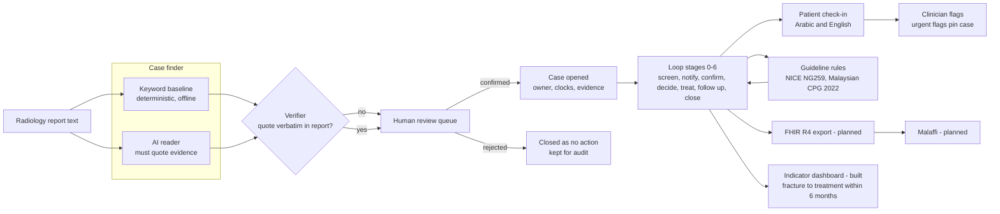

# OsteoLoop: submission pack (DRAFT)

Future Health Digital Innovation Challenge 2026, Department of Health Abu Dhabi (run on Hack2skill). Track: Population Health, Statement 3, *Closing the Screening-to-Care Loop*.

> **Status.** Draft, prepared from public sources and the repo's own documents. Every product number is copied from the repo's README and bench results. Clinical rules are drafts awaiting clinician sign-off. All patients are fictional and all data is synthetic. The official submission requirements (video length, deck template, forms) are not yet confirmed.

Source convention: every number or factual claim links to a source that was opened. Claims marked **[UNVERIFIED: ...]** could not be confirmed and must be checked before submission.

---

## 1. One-line pitch

OsteoLoop reads radiology reports to find fragility fractures that were already documented and never treated, then owns every step from that finding to treatment, with named owners, clocks and a closure gate.

---

## 2. The problem

**Fractures are documented but not acted on.** An incidental vertebral fracture in a chest X-ray report is the typical case. A review of 157 patients aged 50 and over with a hip fracture and prior spine imaging found that 54% of detectable vertebral fragility fractures were not reported by the radiologist at the first opportunity. Musculoskeletal radiologists reported 89% of fractures, and non-musculoskeletal radiologists reported 14% ([Mitchell et al., Archives of Osteoporosis, 2017](https://www.springermedizin.de/reporting-of-vertebral-fragility-fractures-can-radiologists-help/13354212)). Only 25% of those patients were documented as on bone-specific therapy at the time of the hip fracture (same source). This is a single-centre study in Oxford, so treat the figures as indicative.

**Most patients after a fracture never reach treatment.** An INTERCEPT trial protocol states that "70-80% of patients are inadequately investigated or treated for osteoporosis following an initial fracture" ([Wang et al., BMC Primary Care, 2024; DOI](https://doi.org/10.1186/s12875-024-02601-3)). A 2026 Taiwanese single-centre cohort of 6,171 operations found recorded one-year treatment initiation of 43.1% after hip fracture fixation, 17.4% after lumbar fusion and 7.2% after total knee arthroplasty. Its authors note that treatment outside the study hospital was not captured, so these are lower bounds ([Hsu et al., J Clin Med, 2026; DOI](https://doi.org/10.3390/jcm15197683)). Across all operations, an accompanying fracture diagnosis was associated with treatment initiation (adjusted OR 6.19), so the gap follows whether a fracture was the reason for the operation.

**The next fracture is the most likely one.** After a vertebral fracture in postmenopausal women, the cumulative incidence of a new vertebral fracture in the following year was 19.2% among women who had an incident fracture. The placebo-arm cohort mean age was 74 ([Lindsay et al., JAMA, 2001; DOI](https://doi.org/10.1001/jama.285.3.320)). About one in four people die within a year of a hip fracture. Pooled one-year mortality was 24.2% across 12 studies (4,220 patients) in an Irish systematic review ([Walsh et al., Osteoporosis International, 2023; DOI](https://doi.org/10.1007/s00198-023-06713-x)), and 18% in a meta-analysis of Spanish registries covering 55,680 patients ([Núñez et al., 2024; DOI](https://doi.org/10.1016/j.recot.2024.09.010)).

**Burden in the UAE and GCC.** The only UAE figures I could open are old and from one hospital. A 2011 report describes a "recent study" of 1,825 people at an Abu Dhabi hospital, in which almost a quarter had osteopenia and 2.4% had osteoporosis. The authors and year are not named ([The National, 2011](https://www.thenationalnews.com/uae/health/bone-disease-risk-for-1-in-4-residents-1.445617)). A 2026 UAE primary-care review confirms that osteoporosis is a growing concern but gives no national prevalence figure ([Al Sheikh, J Family Med Prim Care, 2026; DOI](https://doi.org/10.4103/jfmpc.jfmpc_2215_25)). **[UNVERIFIED: national UAE fragility fracture incidence or treatment-gap data. None found in opened sources.]**

**Existing indicators do not measure it.** DoH Abu Dhabi's 2025 orthopaedic Jawda guidance has nine indicators, OS001 to OS009: surgical site infection, readmission, unplanned return to theatre, emergency visits, 90-day mortality and transfusion. None covers osteoporosis, fragility fracture, bone density or treatment after fracture ([DoH Abu Dhabi, Jawda Orthopedic Surgery guidance V4.2, 2025](https://www.doh.gov.ae/-/media/Feature/Muashir/Jawda/Jawda2025/Orthopedic-Surgery-Jawda-Guidance-V422025.ashx)).

---

## 3. What OsteoLoop does

**Step by step:**

1. **Read.** The case finder reads radiology report text and finds documented fragility fractures. Each one is categorised as act, review or no action.
2. **Find.** Two readers run side by side: a deterministic keyword baseline (with negation, hedging, trauma and tumour handling) and an AI reader. The final decision is whichever ranks higher. The baseline is transparent and works offline.
3. **Verify.** Every AI finding must quote a sentence that `verify()` finds verbatim in the report. A finding that cannot be verified goes to human review. It never opens or closes a case by itself.
4. **Human review or case opened.** A clinician sees the quoted sentence, highlighted in the report, and confirms or rejects it. Clinicians type nothing extra. "No action" items stay listed for audit and are never auto-dismissed.
5. **Loop.** A confirmed case moves through seven stages, each with an owner and a clock: screen, notify, confirm (DXA and labs), decide or refer, treat, follow up, close. Six exception paths cover overdue, unassigned, rejected referral, misunderstanding, declined treatment and transfer.
6. **Rules.** Stage decisions use deterministic rules from NICE NG259 (2026) and the Malaysian CPG on postmenopausal osteoporosis (2022). Every rule is tagged with its source. Rules marked `LOCAL` await clinician sign-off.
7. **Patient check-in.** Before each clinic visit the patient answers short questions in English or Arabic. Answers become clinician flags. Urgent flags pin the case until a clinician reviews it. Patient answers never change the risk category on their own.
8. **Closure gate.** A case closes only with evidence (dispensing, adherence check, repeat DXA booked) or a named clinician's documented decision.
9. **Export and measure.** The proposed indicator (section 8) is computed live in the prototype's Health tab from stage timestamps. FHIR export and Malaffi integration are planned (section 7).

**Architecture**

---

## 4. Evidence so far

All figures are copied from the repo's [README](../README.md) and [bench README](../bench/README.md). The benchmark runs on synthetic data written by the team. The labels are drafts and have not been signed off by a clinician.

| Measure | Result | Caveat |
| --- | --- | --- |
| Clinical vignettes (rules engine) | 57/57 cases, 102/102 checks | Expected answers written by hand from guideline thresholds; not yet signed off |
| Very-high-risk recall | 13/13 | Synthetic vignettes only |
| False reassurance (at-risk patient labelled "low") | 0 | Synthetic vignettes only |
| Guideline-blocked drug offered | 0 | Synthetic vignettes only |
| Patient check-in flags | 27/27 answer sets | Synthetic answer sets only |
| Case finder, keyword baseline, development set | 99% exact; 48/48 fractures caught; 0 silently dismissed (100 reports) | Written alongside the baseline, so tuned to it. Not blind |
| Case finder, keyword baseline, stress set | 33% exact; 3/12 fractures caught; **6 silently dismissed**; 6/12 surfaced to a human (15 reports) | Written afterwards with unfamiliar wording. This is the baseline, not the AI reader |
| Case finder, AI reader (Claude, one run, synthetic, not blind) | Dev 94% exact, 43/48 act caught; stress 67%, 8/12 caught; 0 silently dismissed on both; errors went to review | See docs/numbers.md |
| Loop guarantees (headless tests on the real app) | 26/26 scenarios | Tests the app's own rules, not clinical outcomes |

**What these numbers show.** The baseline's six silent dismissals on clinical shorthand are the reason for the AI reader and the verifier. They are the failure the AI reader is meant to remove. The keyword numbers do not show that the AI reader works.

**What they do not show.** None of these results shows clinical validity, safety on real patients, or that the loop improves treatment rates. A blind report set written by clinicians who have not seen the rules is still needed before the finder's numbers are claimed.

---

## 5. Comparison with existing approaches

Prior art validates the problem. Most of these approaches are good and OsteoLoop builds on the same ideas. The table compares what each one needs and what it closes.

| | Kaiser Permanente Southern California Healthy Bones | Fracture liaison services (FLS) | Imaging AI for opportunistic vertebral fracture (e.g. Nanox HealthOST) | EHR alerts, registries and NLP case finding | OsteoLoop |
| --- | --- | --- | --- | --- | --- |
| **Input needed** | Not described in the source I opened **[UNVERIFIED]** | Hospital fracture referrals, often by hand | CT scans of spine, adults 50+ ([Nanox, 2022](https://www.gurufocus.com/news/1698391/nanox-announces-fda-clearance-for-healthost-device-an-ai-software-measuring-vertebral-compression-fractures-and-low-bone-density-which-are-often-associated-with-osteoporosis)) | Radiology report text or EHR data | Radiology report text, plus the screening record, DXA and labs |
| **Finds incidental fractures** | Not described in the source I opened **[UNVERIFIED]** | Only fractures that reach the FLS | Yes, on CT only. It flags compression fractures and low bone density | Yes for NLP tools ([Kolanu et al., 2021](https://doi.org/10.1007/s11657-020-00859-5)). Lower sensitivity for minimal-trauma fractures ([Blaker et al., 2021](https://doi.org/10.1007/s00198-021-06105-z)) | Yes, with a verifier and human review |
| **Closes the loop with a named owner** | Not described in the source I opened **[UNVERIFIED]** | Yes, with a coordinator who follows the patient | No. It produces a finding | Usually no. Alerts go to a clinician | Yes: owner, clock and closure gate at each stage |
| **Patient engagement** | Not described in the source I opened **[UNVERIFIED]** | Usually by coordinator contact | No | Usually no | Check-in in Arabic and English before each visit |
| **Infrastructure cost** | Not stated in the source I opened **[UNVERIFIED]** | Staff-heavy. Funding is a known constraint ([Javaid, 2021](https://pmc.ncbi.nlm.nih.gov/articles/PMC8302543)) | Needs CT and a vendor licence. Does not need report text | Needs EHR access and an NLP service | Software on the hospital's record system. Cost not yet estimated |

**Notes on the rows.**

- **Kaiser Healthy Bones.** A news report of a study in *The Journal of Bone & Joint Surgery* says the programme reduced hip fractures by an average of 37.2% in people at risk ([BioSpace, 2008](https://www.biospace.com/healthy-bones-program-reduces-hip-fractures-by-37-percent-kaiser-permanentesouthern-california-study-finds)). The primary article has not been opened **[UNVERIFIED: primary citation and design]**. Javaid (2021) notes that the Kaiser result had no contemporaneous control group ([Javaid, 2021](https://pmc.ncbi.nlm.nih.gov/articles/PMC8302543)). The design limits how strongly the result can be cited.
- **FLS.** A narrative review reports refracture reductions ranging from 7% to 80% across studies, with the author attributing much of the spread to bias. The Swedish four-hospital study reported an 18% reduction in recurrent major osteoporotic fractures ([Javaid, 2021](https://pmc.ncbi.nlm.nih.gov/articles/PMC8302543)). A meta-analysis by Wu et al. (*Bone*, 2018) reported treatment initiation rising from 17.2% to 38% with FLS. I took these figures from a Healio summary, not the paper itself ([Healio, 2018](https://www.healio.com/news/endocrinology/20180517/fracture-liaison-service-increases-bmd-testing-osteoporosis-treatment)). FLS staffing and funding limits are the main reason OsteoLoop is positioned as a tool for a care team, not a replacement for one.
- **Imaging AI.** HealthOST received FDA 510(k) clearance, reported in April 2022. The 510(k) number was not in the source I opened **[UNVERIFIED: 510(k) number and date; check the FDA database]**. It works on spine CT, not plain radiographs. It is a complementary route to finding vertebral fractures, not a competitor for report-based case finding.
- **EHR and NLP tools.** XRAIT, a radiology-report NLP tool, flagged 433 fractures in 5,089 reports at its development site, of which 421 were true (PPV 97%). It found about three times as many fractures as manual case finding. In an external cohort it had sensitivity 70% and specificity 92% ([Kolanu et al., Archives of Osteoporosis, 2021; DOI](https://doi.org/10.1007/s11657-020-00859-5)). A separate evaluation of two electronic search tools in Sydney found that both reliably identified any fracture (true positive rate 77 to 88%) but missed minimal-trauma fractures to different degrees (53 to 75% accuracy) ([Blaker et al., Osteoporosis International, 2021; DOI](https://doi.org/10.1007/s00198-021-06105-z)). The Sydney INTERCEPT cluster trial, which uses NLP on radiology reports to alert primary-care physicians, is registered as a protocol ([Wang et al., 2024; DOI](https://doi.org/10.1186/s12875-024-02601-3)). This is the closest prior art to OsteoLoop's finder and loop, and its results are not yet reported.

---

## 6. Safety design

- **The AI never sets the risk category or the treatment.** The deterministic rules engine does that, using guideline thresholds. The AI reads report text only.
- **Verified evidence.** Every AI finding must quote a sentence that appears verbatim in the report. A finding that fails verification goes to human review.
- **Human review in the loop.** Nothing opens or closes a case from the AI alone. Unverifiable output goes to a clinician.
- **Nothing is silently dismissed.** "No action" items stay listed for audit.
- **Deterministic, sourced rules.** Every rule is tagged with its source (`NICE`, `MYCPG`, `FRAX`, or `LOCAL` pending sign-off). Guideline-blocked drugs are never offered. The benchmark enforces this.
- **Patient answers never change the category alone.** A clinician confirms first.
- **Closure requires evidence or a named decision.** A case cannot close without dispensing, an adherence check or repeat DXA, or a clinician's documented decision.
- **Known risk: AI misreading.** The stress set shows what a keyword rule misses. The AI reader's miss rate on real reports is unknown until it is measured.

---

## 7. Deployment, data residency and regulation (plan, not done)

> Everything in this section is a plan. None of it is built or approved.

**Data residency.** Federal Law No. 2 of 2019 on the use of ICT in healthcare says health data "cannot be stored, processed, generated, or transferred outside of the UAE" unless a health authority or the Ministry approves the activity by resolution. The source I opened says the breach fine is AED 500,000 to AED 700,000 ([Tamimi Law, on Federal Law No. 2 of 2019](https://tamimi.com/law-update-articles/the-federal-law-regulating-the-use-of-information-and-communication-technology-in-the-uae-healthcare-sector)). **[UNVERIFIED: article number and the current status of the implementing regulations. The source is from 2019 and says they were expected "imminently." Cabinet Decision No. 32 of 2020 is not confirmed.]**

**Plan.**
- Host in a UAE cloud region or on-premises, so that identifiable report text never leaves the country.
- De-identify before any call to an external model, and do not send identifiable text to a model outside the UAE.
- Keep the model swappable (model-agnostic), so a UAE-hosted model can replace a foreign one without changing the verifier or the rules.
- Integrate through Malaffi, the Abu Dhabi health information exchange. Malaffi connection figures from 2020 are reported as more than 60% of hospitals in Abu Dhabi and over 500 connected facilities ([Gulf News, 2020](https://www.gulfnews.com/uae/health/more-than-60-per-cent-of-hospitals-in-abu-dhabi-now-digitally-connected-1.73581510)). The FHIR R4 interface is planned. **[UNVERIFIED: Malaffi's required standards and its FHIR interface. The source I opened does not mention them.]**

**AI policy.** DoH Abu Dhabi issued a policy on AI in healthcare that sets minimum requirements, including "auditable validation statements", and regular audits of AI functionality reported to DoH. The policy leaves transparency and oversight to future regulation ([Tamimi Law, 27 June 2018](https://tamimi.com/news/new-policy-on-artificial-intelligence-in-healthcare-issued-by-the-department-of-health-abu-dhabi)). **[UNVERIFIED: whether this 2018 policy has been replaced. Check the current DoH AI policy before submission.]**

**Regulatory path (plan).** Position OsteoLoop as clinical decision support that a clinician reviews. The regulatory classification under DoH and any medical device rules must be confirmed with DoH before deployment. **[UNVERIFIED: classification under DoH rules.]**

---

## 8. Proposed indicator for DoH

**Fragility-fracture patients started on osteoporosis treatment within 6 months** of the qualifying fracture or report.

- **Numerator:** patients with a documented fragility fracture who have a dispensing record of anti-osteoporosis treatment within 6 months.
- **Denominator:** adults with a documented fragility fracture in the period.
- **Source:** stage timestamps in OsteoLoop, reconciled with dispensing records.
- **Why it matters:** the 2025 Jawda orthopaedic set does not measure this ([DoH Jawda guidance](https://www.doh.gov.ae/-/media/Feature/Muashir/Jawda/Jawda2025/Orthopedic-Surgery-Jawda-Guidance-V422025.ashx)).
- **Open:** the 6-month window is a proposal. It is not a guideline value and needs the clinical lead's and DoH's agreement. **[UNVERIFIED: any published benchmark for the window.]**

---

## 9. Limitations

Structured with reference to the DECIDE-AI reporting guideline for early-stage clinical evaluation of AI decision support ([Vasey et al., BMJ, 2022; DOI](https://doi.org/10.1136/bmj-2022-070904); also [Nature Medicine, 2022; DOI](https://doi.org/10.1038/s41591-022-01772-9)). DECIDE-AI comprises 17 AI-specific reporting items, with 28 subitems, and 10 generic items.

- **Synthetic data only.** All reports and patients are fictional and hand-written. The results show that the rules and the verifier behave as specified. They are not clinical validation.
- **Non-blind benchmark.** The development reports were written alongside the keyword baseline, so its 99% is tuned to them. The stress set was written afterwards but is still written by the team. A blind set by clinicians who have not seen the rules is needed.
- **AI reader numbers are one unblinded run on synthetic reports** (docs/numbers.md). No real reports, no repeat runs, no UAE-hostable model yet.
- **False-positive rate on real reports is unknown.** Real radiology reports are not in the benchmark.
- **Prototype state.** State is in memory only. A page reload resets the demo. There is no database, authentication or audit trail yet.
- **Unsigned clinical rules.** Rules marked `LOCAL` and the expected answers have not been signed off. Stage clocks and the 2-year repeat-DXA interval are local choices, not guideline values.
- **Arabic not reviewed.** The Arabic patient messages need review by a native-speaking clinician. They use the feminine form, because the CPG population is postmenopausal women.
- **Scope.** The Malaysian CPG covers postmenopausal women. The app warns when the patient is outside that scope.
- **No independent review recorded.** The repo documents I read record no independent review of the code, rules or clinical content.

---

## 10. The ask

**A read-only retrospective pilot at one hospital.**

- **Data:** 12 months of radiology report text from one hospital, de-identified, read in place. No write access to clinical systems.
- **Duration:** 4 weeks.
- **Output:** the number of documented fragility fractures with no recorded treatment, each with its quoted evidence, reviewed by a clinician.
- **Measures:** precision and recall against a clinician-labelled sample; time per report; number of cases a team would have to act on.
- **Then:** if the pilot supports it, a live loop with owners, clocks and the closure gate, starting with one clinic.

**What we need from DoH:** permission and a named contact for the data request, and guidance on the data residency route.

---

## 11. Three-minute video script

The hook is a fictional patient. The numbers come from section 2.

| Time | On screen | Voice-over |
| --- | --- | --- |
| 0:00 to 0:15 | A chest X-ray with the report text. Title card: "OsteoLoop" | "A 71-year-old woman has a chest X-ray for a cough. The report mentions, almost in passing, an incidental T8 compression fracture." (Fictional patient.) |
| 0:15 to 0:30 | The report sentence, highlighted | "Nobody acts on it. And she is one of the lucky ones: in one study, over half of detectable vertebral fragility fractures were not reported at the first opportunity. Reported or not, most go untreated." ([Mitchell et al., 2017](https://www.springermedizin.de/reporting-of-vertebral-fragility-fractures-can-radiologists-help/13354212)) |
| 0:30 to 0:50 | A timeline: "18 months later" | "Eighteen months later, she falls and fractures her hip. Her next fracture is the one most likely to come. After a vertebral fracture, about one in five women have another within a year." ([Lindsay et al., 2001](https://doi.org/10.1001/jama.285.3.320)) |
| 0:50 to 1:10 | Stacked bars: "70 to 80% not investigated or treated" | "Most people who break a bone are never treated for it. Across one study, 70 to 80% of patients are inadequately investigated or treated after a first fracture." ([Wang et al., 2024](https://doi.org/10.1186/s12875-024-02601-3)) |
| 1:10 to 1:35 | Finder reads a report. Keyword baseline and AI reader side by side. Verifier turns the quoted sentence green | "OsteoLoop reads the report text. Every finding must quote the sentence it relies on. If the quote isn't in the report, a person reviews it." |
| 1:35 to 2:00 | Case board: owner, clock, stage 0 to 6 | "Each confirmed case gets a named owner, a clock for every stage, and a closure gate. A case closes only with evidence, or a clinician's written decision." |
| 2:00 to 2:20 | Patient check-in, Arabic and English | "Before each visit, the patient answers a short check-in in her own language. Urgent answers pin the case until a clinician reviews them." |
| 2:20 to 2:40 | Benchmark slide: "Stress set: keyword baseline 33% exact. AI reader: [to be measured]" | "We are honest about our limits. The keyword baseline missed six of twelve real fractures on clinical shorthand, which is why we added an AI reader with a verifier. Our data is synthetic and our rules await sign-off." |
| 2:40 to 3:00 | Ask slide: "4-week read-only pilot, one hospital, 12 months of report text" | "We ask for a four-week read-only pilot at one hospital. The output is the number of untreated fragility fractures, each with its evidence. Then a live loop, one clinic at a time." |

---

## 12. Sources

Bibliographic details for PubMed-indexed articles were retrieved from PubMed. DOIs are given where they were returned.

1. Mitchell RM, Jewell P, Javaid MK, McKean D, Ostlere SJ. Reporting of vertebral fragility fractures: can radiologists help reduce the number of hip fractures? *Archives of Osteoporosis*, 2017. [Springer Medizin](https://www.springermedizin.de/reporting-of-vertebral-fragility-fractures-can-radiologists-help/13354212)
2. Wang M, et al. Integrated model of secondary fracture prevention in primary care (INTERCEPT): protocol for a cluster randomised controlled trial. *BMC Primary Care*, 2024. [DOI](https://doi.org/10.1186/s12875-024-02601-3)
3. Hsu YS, et al. Variation in osteoporosis treatment gaps across fracture-related and elective orthopedic surgeries. *Journal of Clinical Medicine*, 2026. [DOI](https://doi.org/10.3390/jcm15197683)
4. Lindsay R, et al. Risk of new vertebral fracture in the year following a fracture. *JAMA*, 2001. [DOI](https://doi.org/10.1001/jama.285.3.320)
5. Walsh ME, et al. Long-term outcome collection after hip fracture in Ireland: a systematic review. *Osteoporosis International*, 2023. [DOI](https://doi.org/10.1007/s00198-023-06713-x). Also Núñez JH, et al. Hip fractures in Spain: systematic review and meta-analysis of published registries. *Rev Esp Cir Ortop Traumatol*, 2024. [DOI](https://doi.org/10.1016/j.recot.2024.09.010). Retrieved via PubMed.
6. Al Sheikh AA. Comprehensive clinical review of osteoporosis in older adults: a UAE primary care perspective. *Journal of Family Medicine and Primary Care*, 2026. [DOI](https://doi.org/10.4103/jfmpc.jfmpc_2215_25)
7. The National. Bone disease risk for 1 in 4 residents, 2011. [Link](https://www.thenationalnews.com/uae/health/bone-disease-risk-for-1-in-4-residents-1.445617)
8. DoH Abu Dhabi. Orthopedic Surgery Jawda Guidance V4.2, 2025. [PDF](https://www.doh.gov.ae/-/media/Feature/Muashir/Jawda/Jawda2025/Orthopedic-Surgery-Jawda-Guidance-V422025.ashx)
9. BioSpace. Healthy Bones Program reduces hip fractures by 37 percent, Kaiser Permanente Southern California study, 2008. [Link](https://www.biospace.com/healthy-bones-program-reduces-hip-fractures-by-37-percent-kaiser-permanentesouthern-california-study-finds)
10. Javaid MK. Efficacy and efficiency of fracture liaison services to reduce the risk of recurrent osteoporotic fractures. *Aging Clinical and Experimental Research*, 2021. [PMC](https://pmc.ncbi.nlm.nih.gov/articles/PMC8302543)
11. Wu CH, et al. *Bone*, 2018, as summarised by [Healio, 2018](https://www.healio.com/news/endocrinology/20180517/fracture-liaison-service-increases-bmd-testing-osteoporosis-treatment). Primary article not yet opened.
12. Nanox.AI HealthOST FDA clearance, April 2022. [GuruFocus release](https://www.gurufocus.com/news/1698391/nanox-announces-fda-clearance-for-healthost-device-an-ai-software-measuring-vertebral-compression-fractures-and-low-bone-density-which-are-often-associated-with-osteoporosis). FDA database entry not yet checked.
13. Kolanu N, et al. Natural language processing of radiology reports for the identification of patients with fracture. *Archives of Osteoporosis*, 2021. [DOI](https://doi.org/10.1007/s11657-020-00859-5)
14. Blaker K, et al. Electronic search programs are effective in identifying patients with minimal trauma fractures. *Osteoporosis International*, 2021. [DOI](https://doi.org/10.1007/s00198-021-06105-z)
15. Tamimi Law. Federal Law regulating the use of ICT in the UAE healthcare sector. [Link](https://tamimi.com/law-update-articles/the-federal-law-regulating-the-use-of-information-and-communication-technology-in-the-uae-healthcare-sector)
16. Tamimi Law. New policy on artificial intelligence in healthcare issued by DoH Abu Dhabi, 27 June 2018. [Link](https://tamimi.com/news/new-policy-on-artificial-intelligence-in-healthcare-issued-by-the-department-of-health-abu-dhabi)
17. Gulf News. More than 60 per cent of hospitals in Abu Dhabi now digitally connected, 2020. [Link](https://www.gulfnews.com/uae/health/more-than-60-per-cent-of-hospitals-in-abu-dhabi-now-digitally-connected-1.73581510)
18. Healio. Fracture liaison service increases BMD testing, osteoporosis treatment, 2018. [Link](https://www.healio.com/news/endocrinology/20180517/fracture-liaison-service-increases-bmd-testing-osteoporosis-treatment)
19. NICE. NG259 Osteoporosis: risk assessment, published 29 July 2026. [Evidence page](https://www.nice.org.uk/guidance/ng259/evidence). The fast-track recommendation was not on the page opened.
20. Sunway Medical Centre. A summary of the Malaysian Clinical Practice Guidelines on the management of postmenopausal osteoporosis, 2022. [Link](https://www.sunwaymedical.com/en/research-publications/a-summary-of-the-malaysian-clinical-practice-guidelines-on-the-management-of-postmenopausal-osteoporosis-2022). The summary gives no FRAX cut-offs. The full CPG (PubMed 37496985) has not been checked. **[UNVERIFIED: the CPG thresholds used in `src/rules.js` against the full text.]**
21. Vasey B, et al. Reporting guideline for the early-stage clinical evaluation of decision support systems driven by AI: DECIDE-AI. *BMJ*, 2022. [DOI](https://doi.org/10.1136/bmj-2022-070904)
22. Vasey B, et al. DECIDE-AI. *Nature Medicine*, 2022. [DOI](https://doi.org/10.1038/s41591-022-01772-9)
23. OsteoLoop repo: [README](../README.md), [bench README](../bench/README.md), [bench/results/finder.md](../bench/results/finder.md).
